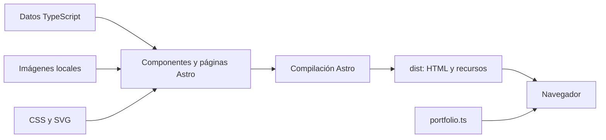

# Arquitectura del portafolio

## Generación y ejecución

Astro compila las páginas a HTML, CSS, JavaScript e imágenes optimizadas. `astro.config.mjs` define `output: 'static'` y rutas con barra final. No hay API, autenticación, CMS, base de datos ni llamadas a los proyectos externos para generar la página.

Las tecnologías PHP, WooCommerce, PostgreSQL o Redis que aparecen en las fichas describen otros proyectos o ejemplos. No son dependencias de ejecución del portafolio.

## Responsabilidades

| Ubicación | Responsabilidad |
| --- | --- |
| `src/layouts/Newspaper.astro` | HTML en español, estilos globales, fuentes locales, metadatos y script compartido |
| `src/pages/index.astro` | Componer presentación, proyectos, experiencia, formación, herramientas y contacto |
| `src/components/SiteHeader.astro` y `SiteFooter.astro` | Marca, navegación, regreso y control de movimiento |
| `src/components/ProjectCard.astro` | Tarjeta compartida por portada y listado, acciones y doblez |
| `src/components/Action.astro` | Enlaces disponibles, protección de enlaces externos y estados pendientes |
| `src/components/ContactPanel.astro` | Accesos de contacto, Octocat y botón de CV |
| `src/data/portfolio.ts` | Perfil, publicación, tarjetas, experiencia, formación y herramientas |
| `src/types/project-details.ts` | Contratos de casos, procesos, módulos, nodos y conexiones |
| `src/data/project-details.ts` | Cuatro variantes y colección de casos reales |
| `src/data/evox-case-study.ts` y `tenso-case-study.ts` | Contenido técnico de cada caso |
| `src/data/project-modules.ts` | Módulos de ANDEC, EVOX y ejemplos de aplicación/API |
| `src/styles/global.css` y `project-details.css` | Sistema visual y adaptaciones de las fichas |

## Generación de rutas

`src/pages/proyectos/[slug].astro` genera páginas para los elementos de `caseStudies` con `projectId` y `mode: 'reference'`. La URL utiliza **`projectId`**, no el campo `slug` del template.

`src/pages/plantillas/[template].astro` genera las cuatro vistas de `templateStudies` usando su `slug`. ANDEC y EVOX también sirven como referencias de sus variantes; Tenso reutiliza la variante `static` sin crear una quinta plantilla.

`publishedProjects` filtra las tarjetas que tienen `siteUrl`, `demoUrl` o `detailsUrl`. El marcador personal sigue visible en inicio, pero no aparece en el listado de trabajos disponibles.

## Estructura de una ficha

`ProjectDetails.astro` compone la portada y estos bloques:

1. `ProcessTimeline`: definición, diseño, construcción e integración con una descripción breve y piezas del desarrollo.
2. `ArchitectureMap`: conexiones reales y responsabilidad de los componentes, sin pie de auditoría ni texto emergente.
3. `ImplementationModules`: desarrollo propio frente a base tecnológica, archivos y dependencias.
4. Decisiones técnicas opcionales: necesidad, elección y efecto.

`ProjectVisual.astro` presenta únicamente el visual del hero. No hay galerías adicionales. Los mapas mantienen un nombre accesible con `aria-label` y una descripción de sus nodos y conexiones con `aria-describedby` y `<desc>`; no utilizan `<title>` de SVG para evitar el tooltip nativo.

`ProcessStage.evidence` conserva el registro interno de documentación, pero no se renderiza. Solo las fases pendientes muestran «Por documentar». Su detalle está en [pendientes de documentación](project-documentation.md). Los avisos de ejemplo se conservan para las dos variantes ilustrativas; las fichas reales no muestran avisos de auditoría del código.

### Mapas de arquitectura

`ArchitectureMap.astro` genera SVG durante el build. Recibe nodos con posición por `column` y `row`, conexiones por identificador y grupos opcionales que representan entornos de ejecución. Produce composiciones de escritorio y móvil, sin una biblioteca de grafos en el navegador.

La leyenda distingue `custom` (desarrollo propio), `platform` (base tecnológica) y `external` (servicio externo) mediante bordes y color. Las flechas se etiquetan con lo que circula; los grupos no deben confundirse con pasos de una operación.

## JavaScript del navegador

`src/scripts/portfolio.ts` añade dos mejoras sobre el HTML existente:

- **Movimiento:** gestiona `data-motion-state`, observa ilustraciones con `IntersectionObserver`, responde a `visibilitychange` y `prefers-reduced-motion`, y guarda la pausa en `localStorage` bajo `daily-post:motion-paused`. Si el almacenamiento falla, mantiene la preferencia durante la visita.
- **Navegación:** mide la cabecera con `ResizeObserver`, conserva visible la franja de navegación, reserva espacio para anclas y actualiza la sección activa. Los eventos de scroll se agrupan mediante `requestAnimationFrame`.

Sin JavaScript, el contenido, enlaces e ilustraciones permanecen disponibles; la cabecera queda en el flujo y las ilustraciones estáticas. Las animaciones se definen en CSS.

## Imágenes, fuentes y metadatos

Las imágenes de `src/assets/` se importan como `ImageMetadata` y se renderizan con `astro:assets`. El retrato PNG conserva transparencia; las capturas se sirven en variantes WebP con dimensiones reservadas. El contenido bajo la portada utiliza carga diferida.

Playfair Display y Source Serif 4 se empaquetan desde Fontsource y se sirven localmente. Los archivos de `public/` se copian sin transformación; la imagen social se regenera con `scripts/generate-social-image.mjs`.

El layout solo genera canonical y URLs sociales absolutas cuando se configura `Astro.site`. Una ficha es borrador si es un ejemplo o alguna fase está `pending`; los borradores y las vistas de plantilla reciben `noindex, follow`.
